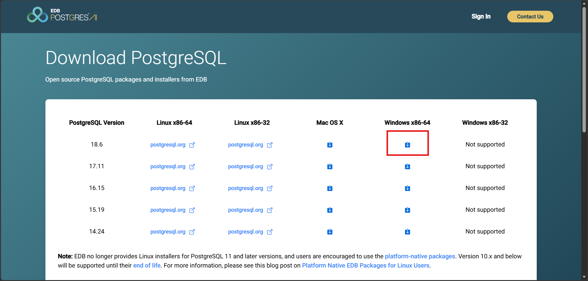

# WinStock
WinStock es un sistema web con tecnología PWA para la gestión de inventarios de alimentos para ganado
 e insumos de maquinaria del Fundo San Carlos.


## Django version 6.1.2

para que todos tenga la misma version de Django, instalen los requerimientos 

``` sh
pip install -r requirements.txt
```

### Base de datos
1. Deben de tener instalado PostgreSql -> https://www.enterprisedb.com/downloads/postgres-postgresql-downloads


2. Al instalar PostgreSql este ya incluye su plataforma propia para administrar bases de datos PostgresSql "pgAdmin 4"

3. Entrar a pgAdmin4 (con la contraseña que creaste durante la instalacion de PostgresSql)
    1. Expandir servers
    2. Ingresar contraseña
    3. Dirigirse a login-->(click derecho)-->(crear)

4. Configurar usuario
    1. General -->name: winStock_user
    2. Definition -->password: winStock_user
    3. Privilegios -->login:true , superuser:true 

5. Configurar base de datos 
    1. Click derecho -> create
    2. General -->database: winStock_db
    3. Asignar usuario creado
    4. Deficion --> comprobar que esta en utf8

6. Crear un archivo .env y configurarlo
    

7. Deben de crear la base de datos mediante las migraciones de Django
    ``` sh
    python manage.py makemigrations

    python manage.py migrate
    ```

con esto se deberian crear todas las tablas en su DBMS